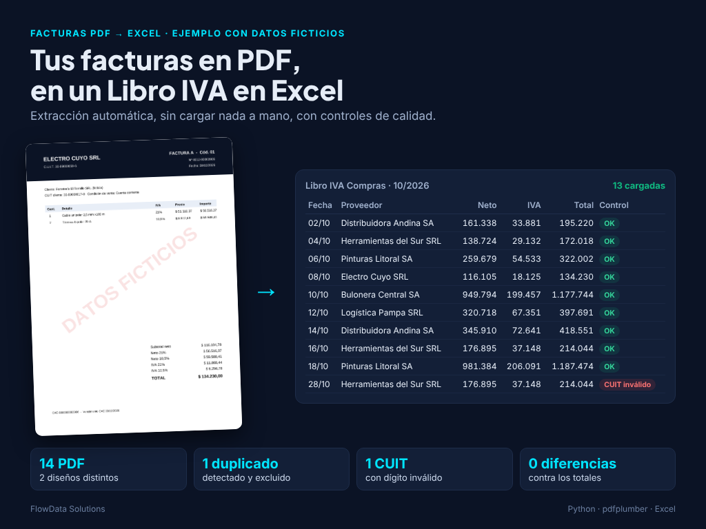

# Ejemplo 6 — Facturas en PDF a Libro IVA Compras en Excel

> **Ejemplo con datos ficticios.** Proveedores, CUIT y montos son inventados; cada PDF lleva la marca "DATOS FICTICIOS".



## El problema
Un comercio recibe todos los meses decenas de facturas de compra en PDF, cada proveedor con su propio diseño. Alguien las abre una por una y copia fecha, número, CUIT, netos, IVA y percepciones a una planilla para el Libro IVA. Es lento, aburrido y propenso a errores: facturas cargadas dos veces, CUIT mal tipeados, montos que no cierran.

## La solución
Un script en Python que lee la carpeta de PDF y arma el libro solo:

| Paso | Qué hace |
|---|---|
| Lectura | Extrae el texto de cada PDF con `pdfplumber`, ignorando marcas de agua |
| Extracción | Reconoce dos diseños de factura distintos con expresiones regulares: fecha, tipo, punto de venta, número, CUIT, razón social, neto e IVA por alícuota (21 % y 10,5 %), percepciones de IIBB y total |
| Normalización | Montos en formato argentino a número, nombres prolijos ("HERRAMIENTAS DEL SUR SRL" → "Herramientas del Sur SRL"), neto repartido por alícuota cuando el proveedor solo informa un subtotal |
| Controles | Dígito verificador del CUIT, duplicados (mismo CUIT + tipo + punto de venta + número), que netos + IVA + percepciones = total, y fecha dentro del período |
| Excel | Hoja **Libro IVA Compras** con totales, hoja **Por proveedor** con fórmulas `SUMAR.SI` y control cruzado, y hoja **Controles** con cada observación |

Si un PDF no se puede leer (por ejemplo, un escaneo sin texto), no frena el proceso: queda listado en Controles para revisarlo a mano.

## Resultado del ejemplo
- 14 PDF leídos, de 6 proveedores y 2 diseños distintos.
- 13 comprobantes cargados en el libro.
- 1 duplicado detectado y excluido.
- 1 CUIT con dígito verificador inválido, marcado en rojo.
- 0 diferencias contra los importes originales (verificado comprobante por comprobante).

## Cómo correrlo
```bash
pip install pdfplumber openpyxl reportlab
python generar_facturas.py          # crea las facturas de ejemplo en facturas/
python extraer_facturas.py          # arma libro_iva_compras.xlsx
python extraer_facturas.py <carpeta_pdf> <salida.xlsx> <MM/AAAA>
```

## Para un cliente real
- Se ajustan los patrones a los diseños de sus proveedores (los más frecuentes primero).
- Las facturas escaneadas necesitan OCR; se cotiza aparte.
- Los datos reales se procesan solo en la carpeta privada del cliente, nunca en este repositorio.
